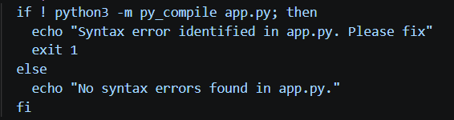
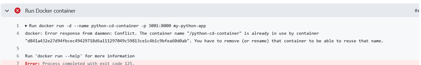
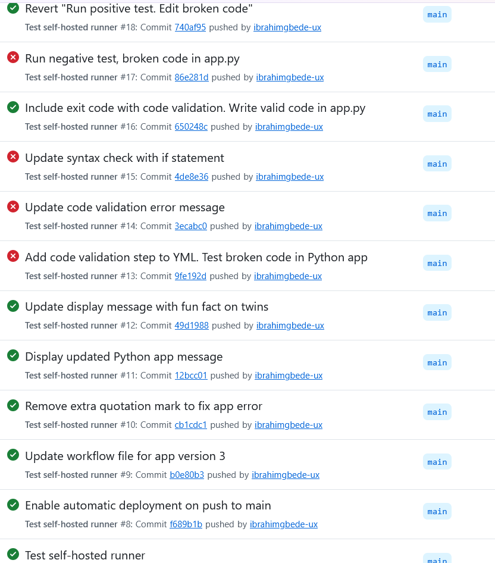

# CI/CD Project #

## Project overview ##
In this project I built a CI/CD environment that automatically updated my Python app when triggered by a push to GitHub Actions. I demonstrate how my pipleline automatically containerises Python code, validates it, builds a docker image and deployed an updated container when I push to git main.

I use py_compile, a non-zero exit-code and a message for syntax validation. If the syntax is invalidate the operation is aborted and the docker image is not built. This allows early error-detection and avoids the deployment of faulty code.

## Project objectives ##
My aim was to remove the need to manually update the configuration for my app by configuring my YML workflow to automatically do the the follwing;
1. containerise my web app using Docker
2. implement CI by using Python to validate syntax
3. build a Docker image
4. replace an old container
5. run an existing one.
6. Deploy application.

I also verified my pipeline worked as intended by negative and positive testing, as well as practiced troubleshooting.

## Technology stack ##
- Python: Web application source code and syntax validation.
- Docker: Application containerisation.
- GitHub Actions: CI/CD management.
- Ubuntu: Self-hosted runner.
- Bash: Scripting
- Git: Version control.
- VS Code: Development environment.

## Pipeline architecture ##

## Implementation ##
1. The workflow is triggered by a push to the main branch.
2. The Python source code is retrieved by Checkout.
3. The self-hosted runner's connection is validated.
4. Python syntax is validated.
5. If syntax is validated, the application is packed into a Docker image.
6. The old Docker container is removed.
7. A new container is built and the app is deployed to port 3001.

Here I used an if conditional and negation operator. So if the py_compile commands fails, the error image is displayed. Yet it is still crucial to include the exit code, because this ensures the operation is aborted.

## Challenges and solutions ##
1. Docker Container Name Conflict

### Problem:### 
My deployment failed due to a name conflict; my new container and existing container had the same name. This revealed an underlying issue: GitHub Actions was unable to remove the old container before creating the latest.

### Solution:###
Inspect YML workflow to ensure container removal is properly configured as a step before Docker image building.

2. Successful Pipeline but Failed Application
## Problem:##
After an update and push, GitHub Actions reported a successful deployment but I could not access the application. This taught me something important: successful deployment is not the same as working application.

## Solution:## 
I used docker ps -a to inspect the container and I found the container stopped and terminated. I used docker logs to inspect the reason and realised there was a syntax error; I accidentally included an extra quotation mark at the end of my display message.

3. ## Local Changes Missing from GitHub ##
Local changes were not reflected on Git

I inspected my committed version using git show HEAD and I noticed my local version included a line of code not found in the Git version. I suspect I forgot to save local changes before committing them.

4. Preventing Invalid Code from Reaching Deployment
   
## Problem:##
I had no means of checking for the validity of syntax, which meant incorrect code could pass to deployment.

## Solution:##
I configured an automated syntax validation quality gate using python3 -m py_compile app.py.

## Testing and validation ##

## Troubleshooting commands ##
 1. docker ps - to inspect running containers.
 2. dockers ps -a - to inspect all containers.
 3. dockers  logs python-container-cd - to check app and container failure.
 4. git show HEAD - to inspect lasted committed changes.
 5. python3 -m python_compile app.py - to validate Python syntax.
 6. git log -1 --oneline - to display last commit in one line.
 
## Key lessons ##
1. A successful CI/CD workflow does not necessarily mean that an application is functioning correctly.
2. Syntax validation can prevent syntactically invalid code from reaching deployment.
3. Exit codes play a fundamental role in automated decision-making.
4. Negative testing is essential for verifying that preventative measures work as intended.
5. Effective troubleshooting requires inspecting logs and verifying assumptions.

## Future improvements ##
1. Introduce automated functional testing using pytest.
2. Implement post-deployment application health checks.
3. Introduce automated rollback for unhealthy deployments.
